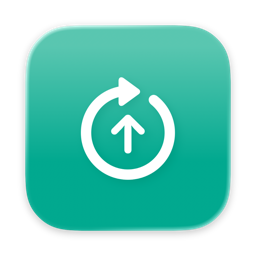

# &nbsp;&nbsp;Actualizate

*Revisa todas las fuentes de actualizaciones de tu Mac a la vez y luego instala solo lo que elijas*

  

**Actualizate** es una app de SwiftUI hecha sobre `actualizar`, un script de zsh que revisa en paralelo Homebrew, la Mac App Store, los feeds de Sparkle, Microsoft AutoUpdate y macOS. La app muestra lo pendiente por sección, marcas lo que quieres actualizar y cada app lleva su propia barra de progreso mientras se instala. El mismo script funciona solo en la Terminal.

[Read in English](README.md)

---

## Funciones

- **Primero revisa, sin cambiar nada:** la revisión corre todas las fuentes en paralelo (unos 30 s) y solo informa.
- **Secciones:**
  - Casks de tu propio tap de Homebrew que subes de versión a mano (opcional, ver [Configuración](#configuración)).
  - Fórmulas de Homebrew.
  - Casks de Homebrew, incluidos los `--greedy`. Se omiten los casks cuya app ya se actualizó sola, así no se reinstala ni se baja de versión nada.
  - Mac App Store, con `mas`.
  - Apps con un feed de Sparkle más nuevo que Homebrew. Se instalan con el instalador de Sparkle después de comprobar la firma EdDSA del fabricante.
  - Apps sin Homebrew ni Sparkle: solo aviso (opcional).
  - macOS y Safari: solo aviso, porque suelen pedir reinicio.
  - Microsoft AutoUpdate, que además se repara cuando le falta su ayudante privilegiado.
- **Barra de progreso por app** al instalar, leída de la salida de Homebrew.
- **Revisión en segundo plano** con notificación cuando hay algo pendiente. Vive en la barra de menús, en el Dock o en ambos.
- **Adopción de apps:** lista todas las apps instaladas con su estado en Homebrew y reemplaza las instaladas a mano por el cask de Homebrew, con respaldo y comprobación completa antes de retirar la original.
- **Actualizar sin contraseña (opcional)** con un pequeño ayudante root (ver abajo).

---

## Requisitos

- macOS 26 o posterior, Apple Silicon (Homebrew en `/opt/homebrew`).
- Xcode 26. El Xcode completo, no solo las Command Line Tools: `actool` compila el icono de Icon Composer.
- [Homebrew](https://brew.sh), más `brew install jq mas`.
- Para la sección de Sparkle: la herramienta de línea de comandos de Sparkle, `sparkle.app` (sparkle-cli, Sparkle 2), en `~/.local/opt/sparkle.app`, sacada de una [versión de Sparkle](https://github.com/sparkle-project/Sparkle/releases).
- Opcional, para actualizar sin contraseña: una identidad de firma emitida por Apple (Apple Development o Developer ID Application) en tu llavero.

---

## Compilar e instalar

```bash
git clone https://github.com/asubervirojas/actualizate.git
cd actualizate
./compilar.sh --instalar
```

Deja la app en `~/Applications/Actualizate.app`. El script la firma con la primera identidad Apple Development o Developer ID Application que encuentre, o con la de `ACTUALIZATE_FIRMA`. Sin ninguna, firma ad hoc y deja fuera el ayudante root.

Después instala los scripts auxiliares que usa el motor y, si quieres el comando en la Terminal, enlázalo:

```bash
mkdir -p ~/.local/bin
install -m 755 ayudantes/brew-casks-pendientes ayudantes/sparkle-pendientes ~/.local/bin/
swiftc -O ayudantes/ed25519-verify.swift -o ~/.local/bin/ed25519-verify
ln -sf ~/Applications/Actualizate.app/Contents/Resources/actualizar ~/.local/bin/actualizar
```

---

## Terminal

```bash
actualizar                                   # revisa e instala todo
actualizar revisar                           # solo revisa, no cambia nada
actualizar instalar --etapas formulas,casks  # instala solo esas secciones
actualizar instalar --casks firefox,vlc      # instala solo esos casks
actualizar adoptables                        # lista las apps instaladas y su estado en Homebrew
actualizar --help
```

El script exporta `HOMEBREW_NO_ASK=1`, así Homebrew 7 no se detiene a preguntar `[y/n]`: ya elegiste qué instalar.

---

## Configuración

Arriba de `Recursos/actualizar` hay dos listas opcionales, con ejemplos:

- `PROPIOS` y `TAP`: casks de tu propio tap a los que el script les sube la versión y el `sha256` a partir de un feed `latest-mac.yml` o de una versión de GitHub.
- `MANUALES`: apps fuera de Homebrew y Sparkle que solo reciben un aviso, cada una con una pequeña función que imprime la última versión.

Vuelve a correr `./compilar.sh --instalar` después de editarlas.

---

## Actualizar sin contraseña (opcional)

Homebrew usa `sudo` para los casks con `.pkg`, `launchctl`, `mas` y algunas operaciones con archivos. En **Ajustes > Contraseña > Actualizar sin contraseña** la app registra un LaunchDaemon que va dentro de ella (`SMAppService`). macOS te pide aprobarlo una vez en Ajustes del Sistema > General > Ítems de inicio y extensiones.

El ayudante:

- Solo acepta conexiones de esta app firmada por el mismo equipo de Apple que él, y solo de cuentas de administrador.
- Solo escribe o borra `/etc/sudoers.d/zz_actualizate`. El texto de la regla está en `Sources/ActualizateRaiz/Regla.swift` y se comprueba con `visudo` antes de ponerla.

La regla es `NOPASSWD:SETENV` para `installer`, `pkgutil`, `launchctl`, comandos de archivos comunes (`rm`, `cp`, `mv`, `chmod`, `chown`, `ditto` y otros), `mas` y el Ruby portátil de Homebrew. Lleva `SETENV` porque Homebrew siempre llama `sudo -E VAR=...`. El archivo se lee después de la regla `brew_setenv` de Homebrew, así que gana.

> [!WARNING]
> Tiene un costo real: cualquier programa que corra con tu usuario podrá usar esos comandos como root sin que se te pregunte. Se quita desde el mismo lugar. Si borras la app sin quitarlo antes, borra la regla a mano: `sudo rm /etc/sudoers.d/zz_actualizate`.

Las herramientas que escriben un icono personalizado dentro de la app rompen la comprobación estricta de su firma, y macOS puede rechazar el ayudante. Deja Actualizate fuera de ellas.

---

## Permisos

La primera vez que actualiza apps, macOS pide para Actualizate:

- **Gestión de apps** (Privacidad y seguridad), para que Homebrew y Sparkle reemplacen apps en `/Applications`.
- **Automatización**, para cerrar y reabrir apps (Microsoft, AdGuard).
- **Notificaciones**, al terminar una instalación o cuando la revisión en segundo plano encuentra algo.

---

## Microsoft AutoUpdate

Microsoft AutoUpdate instala con un ayudante privilegiado, `/Library/PrivilegedHelperTools/com.microsoft.autoupdate.helper`. Si falta, AutoUpdate descarga las actualizaciones pero se queda para siempre en "Installing". Actualizate lo avisa al revisar y, al instalar, primero lo repara con `brew install --cask microsoft-auto-update` y luego espera a que AutoUpdate termine (hasta 45 minutos). Una respuesta vacía o no válida de `msupdate` nunca se toma como "al día".

---

## Adopción de apps

El botón de la caja con flecha (o `actualizar adoptables`) lista todas las apps de `/Applications`, `~/Applications` y `/System/Applications` con su estado: para adoptar, ya en Homebrew, sin gestionar, App Store, de Apple. `actualizar adoptar --casks a,b` instala la copia de Homebrew y comprueba su recibo, destino, bundle id, versión y ejecutable antes de retirar la original. Si algo falla, se restaura el respaldo. Nunca usa `--zap`, no borra datos ni preferencias y no baja de versión.

---

## Registros y pruebas

Cada ejecución queda en `~/Library/Logs/Actualizar/` (las últimas 60).

```bash
python3 -I Tests/test_microsoft.py
python3 -I Tests/test_adoptar.py
```

Las pruebas usan un `msupdate` y un `brew` falsos; no cambian nada en tu Mac.

---

## Desinstalar

1. Si actualizar sin contraseña está activo: **Ajustes > Contraseña > Quitar**.
2. Cierra la app y borra `~/Applications/Actualizate.app`.
3. `rm ~/.local/bin/actualizar` y `defaults delete local.armando.actualizar`.

---

## Notas

- Sin relación con Homebrew, Sparkle, Microsoft ni Apple.
- Hecho con ayuda de IA.

## Licencia

[MIT](LICENSE)
